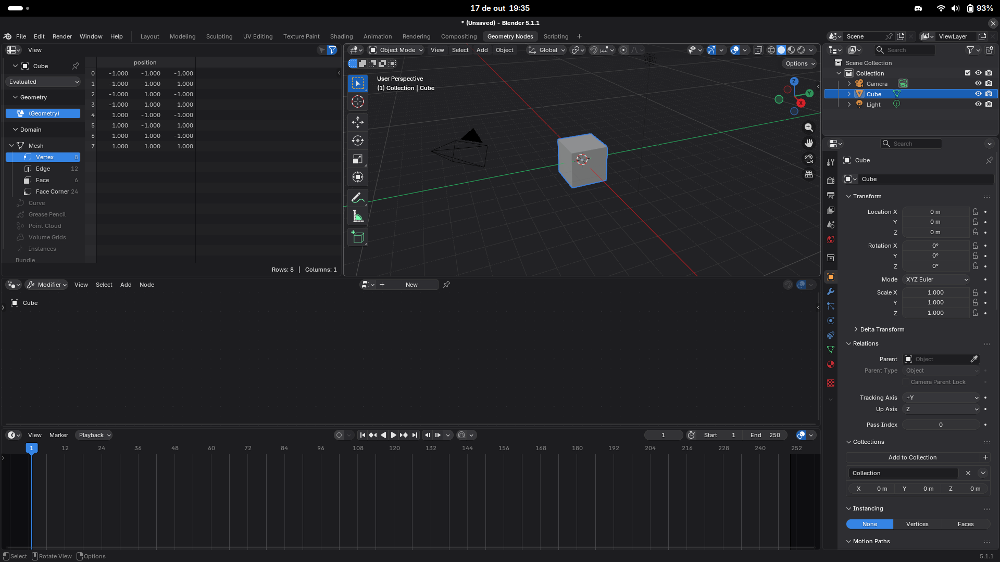

# Libadwaita theme for Blender

Implements a GNOME Libadwaita inspired dark theme for Blender, packaged as an
official [Blender Extension](https://extensions.blender.org/themes/).



## Installation

### From the Extensions platform (Blender 4.2 or newer)

1. Open Blender and go to `Edit > Preferences > Get Extensions`.
2. Search for **Libadwaita** and click the `Install` button.
3. Go to `Edit > Preferences > Themes` and select **Libadwaita**.

### Manual (from a release zip)

1. Download the latest `.zip` from the
   [releases page](https://github.com/flarom/Libadwaita-Blender/releases).
2. Open Blender and go to `Edit > Preferences > Add-ons`.
3. Drop the `.zip` file into the window (or use `Install from Disk`).
4. Go to `Edit > Preferences > Themes` and select **Libadwaita**.

### Manual (raw XML)

1. Download `libadwaita_dark.xml` from the
   [releases page](https://github.com/flarom/Libadwaita-Blender/releases).
2. Open Blender and go to `Edit > Preferences > Themes`.
3. Click on the `Install` button and select the downloaded `.xml` file.

## Repository layout

```
blender_manifest.toml   # metadata required by the extensions platform
libadwaita_dark.xml     # the theme itself
images/thumbnail.png    # preview used by the platform listing
CHANGELOG.md            # version history
LICENSE                 # GPL-3.0-or-later (required by the platform)
.github/workflows/      # builds the .zip automatically on tag
```

## Development

Build and validate the package locally (requires Blender 4.2+ in `PATH`):

```sh
blender --command extension validate --source-dir .
blender --command extension build --source-dir . --output-dir dist
```

The resulting `dist/libadwaita-1.0.0.zip` is what gets uploaded to the platform.

When releasing a new version:

1. Bump `version` in `blender_manifest.toml` (semantic versioning).
2. Add an entry to `CHANGELOG.md`.
3. Commit, then push a tag — the GitHub Actions workflow builds the zip and
   attaches it to the GitHub release automatically.

## Publishing to extensions.blender.org

1. Sign in at <https://extensions.blender.org/submit/>.
2. Upload the built `.zip`.
3. Fill in the submission form (name, description, tags) — the data from
   `blender_manifest.toml` is pre-filled.
4. Wait for review by the Blender team.

> The `id` in `blender_manifest.toml` must stay unique and stable forever; the
> `maintainer` account must be the one submitting the extension.

## Contributing

If you want to contribute to this project, I would love to have your help!

At the moment, there's only a dark theme available, a light theme is still in
needs of development.

## License

[GPL-3.0-or-later](LICENSE) — the license required by the Blender Extensions
platform.